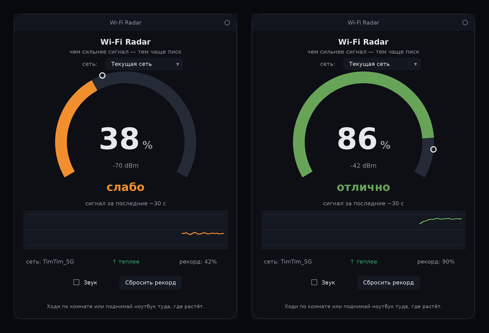

# Wi-Fi Radar

Найди лучшую точку для Wi-Fi на слух и на глаз. Приложение показывает силу
сигнала в реальном времени и пищит тем чаще, чем сигнал сильнее — ходишь по
комнате или поднимаешь ноутбук туда, где показатель растёт. Два быстрых писка
подряд = новый рекорд, лучшая точка из всех пройденных.

Работает на **Linux** и **Windows** (на macOS — по возможности). Из зависимостей —
только стандартная библиотека Python, ничего ставить дополнительно почти не нужно.

> Честно о главном: один ноутбук меряет **силу** сигнала, а не **направление** —
> стрелку «роутер вон там» одна антенна дать не может. Поэтому это игра
> «горячо/холодно»: максимум находишь перемещением. Для бытовой задачи — где
> встать, куда поднять ноут, где лучше ловит 4G-раздача с телефона — этого хватает.

## Как это выглядит



Тёмное окно с круговой шкалой: крупный процент силы сигнала в центре, цвет шкалы
от красного к зелёному, под ним — dBm, живой график силы сигнала за последние
~30 секунд, название сети, тренд (теплее/холоднее) и текущий рекорд. Снизу —
переключатель звука и сброс рекорда.

Вверху — выбор сети: по умолчанию следим за подключённой, но в списке можно
выбрать **любую видимую сеть** и искать её точку (пароль не нужен — уровень
берётся из открытых маячков, которые вещает каждый роутер). У чужой сети данные
обновляются чуть реже — через скан раз в пару секунд.

## Чем отличается от других

Инструменты для силы Wi-Fi есть, но у каждого свой минус для простой задачи
«найди лучшее место дома».

| Инструмент | ОС | Интерфейс | Поиск места по звуку | Что нужно поставить |
|---|---|---|---|---|
| **Wi-Fi Radar** | Linux + Windows | GUI + консоль | **да** | ничего лишнего (Python + Tkinter) |
| macgeiger | только Linux | консоль (ncurses) | да, но нужен monitor mode | сложная сборка на C |
| wavemon | только Linux | консоль | нет | `apt install`, звука нет |
| WiFi Analyzer / inSSIDer / NetSpot | десктоп/телефон | GUI | нет | установка, часть платные |
| «signal meter» приложения | только телефон | GUI | у части есть | из магазина приложений |

Идея «искать точку по звуку» не новая — ближе всего `macgeiger`, но он только под
Linux, требует карту с режимом monitor и непростую сборку на C, и давно не
обновлялся. Фишка Wi-Fi Radar — то же наведение по звуку, но кроссплатформенно,
с графическим окном, живым графиком и без единой внешней зависимости: скачал
один файл и запустил.

## Установка и запуск

### Linux

```bash
# Tkinter обычно уже есть; если приложение пишет, что его нет:
sudo apt install python3-tk

python3 wifi_radar.py
```

Сила сигнала читается напрямую из ядра (`/proc/net/wireless`), поэтому работает
без прав root и не зависит от языка системы. Для звука используется `paplay`
(или `pw-play` / `aplay`) — на большинстве дистрибутивов уже стоит.

**Ярлык в меню приложений** (чтобы запускать кликом, а не из терминала):

```bash
./install-linux.sh
```

Положит иконку и ярлык «Wi-Fi Radar» в меню (в `~/.local`, без root).
Удалить: `./install-linux.sh --uninstall`.

### Windows

1. Установи Python с [python.org](https://www.python.org/downloads/) — Tkinter и
   звук (`winsound`) входят в комплект.
2. Запусти:

   ```cmd
   python wifi_radar.py
   ```

Сила сигнала берётся из `netsh wlan show interfaces` (в процентах).

**Сборка в один .exe** (чтобы запускать на Windows без установленного Python):

```cmd
build-exe.bat
```

Скрипт поставит PyInstaller и соберёт `dist\wifi-radar.exe` — один файл с иконкой,
который можно просто скопировать и запускать на любом Windows.

## Как пользоваться на слух

- **Чаще писк = сильнее сигнал.** Медленно ходишь, слушаешь, идёшь туда, где
  писк учащается.
- **Два быстрых писка** = новая лучшая точка. Так отмечаешь максимум, не глядя
  на экран.
- **«Куда поднять ноут»** — стой на месте и медленно поднимай его / води рукой:
  где писк чаще, там и держи.
- Тон писка слегка растёт вместе с сигналом (на Windows).

## Консольная версия (без графики)

В комплекте есть `wifi-radar.sh` — тот же «звуковой гейгер» для Linux-терминала,
если графика не нужна:

```bash
chmod +x wifi-radar.sh
./wifi-radar.sh
```

## Как это работает

| ОС      | Источник сигнала                          | Единицы |
|---------|-------------------------------------------|---------|
| Linux   | `/proc/net/wireless` → `iw` → `nmcli`     | dBm     |
| Windows | `netsh wlan show interfaces`              | %       |
| macOS   | `airport -I` (если доступно)              | dBm     |

Качество 0–100 % считается из dBm по шкале −90…−30 dBm. Интервал между писками
линейно сжимается от 1.5 с (слабо) до 0.12 с (вплотную к точке).

## Лицензия

MIT — см. [LICENSE](LICENSE).
